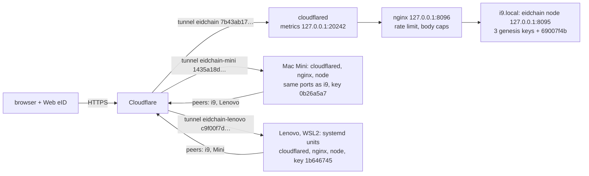

# eidchain.domovina.ai and eID validators

Status on 2026-11-04. Our own chain runs on the stepanic fork, at https://eidchain.domovina.ai/chain/. It tests what we want to propose upstream (ivoras/eidchain): `authority-changes` and `eid-validators`. The how is in the README sections "Key rotation", "eID validators" and "Deployment on macOS". This file holds the reasons, the traps and what is still open.

Related: [Web eID and the newer Croatian eOI on macOS](2026-11-04-web-eid-newer-croatian-eoi-macos.md), [A Windows node, and what hardware a fleet of nodes needs](2026-11-04-windows-node-and-node-hardware.md).

## The live chain

- Genesis `70659df25175…beec8` (public copy in `genesis/domovina-genesis.json`). The 3 genesis keys sit on one host, i9.local, so the "majority" there is one machine.
- Schedule: `block-timestamps` from 1, `authority-changes` and `eid-validators` from 3.
- Blocks 1 and 2 are messages signed with Matija's eOI. Block 3 registers his first validator key, `69007f4b…` (i9). Block 4 (16:40) registers the Mac Mini key `0b26a5a7…` and is signed by `69007f4b`, which made it active. `0b26a5a7` is a candidate until it signs.
- Voters after block 4: N=4 (3 genesis keys + Matija), window 2, rotation quorum 3. The genesis keys still hold the majority from one machine.
- Block 5 (17:00) is a card-signed message, signed by genesis key `20a17442` on i9. The Mac Mini had the message too and did not cut: Matija's voter was still in the window from block 4, which shows the two keys counting as one voter.
- **Why the Mac Mini key rarely gets to sign.** i9 holds 3 genesis keys and Matija's first key, so with a window of 2 it always has an eligible key and cuts every block. The Mac Mini cuts only when Matija's voter has left the window. At the earliest that is block 7, after a non-Matija block 6. Both nodes then cut at the same boundary, and the lowest hash wins, so the Mac Mini has about a 50% chance. Every block needs a pending message, which means a card signature, so a test takes two messages in two separate 10-minute slots, and may need repeating. This goes away once the genesis keys are rotated out.
- Three public nodes, all peers of each other: i9.local (`eidchain-i9.domovina.ai`, also serving the short `eidchain.domovina.ai` as an alias) and the Mac Mini ffhr.local (`eidchain-mini.domovina.ai`, tunnel `eidchain-mini` `1435a18d…`, same `/opt/eidchain` layout and uid 471), and the Lenovo in WSL2 (`eidchain-lenovo.domovina.ai`, tunnel `eidchain-lenovo` `c9f00f7d…`, systemd units `eidchain-{node,nginx,tunnel}` as system user `eidchain`, the same `/opt/eidchain` layout, since 2026-11-09).
- `python3 -I scripts/chain-map.py --pdf` (on i9 with `SSL_CERT_FILE=/etc/ssl/cert.pem`: the python.org build has no CA certificates) draws the current nodes and keys into `docs/chain-map.md`.

**Today the chain is spread over machines, not over people.** All three nodes run a key of the same person (MATIJA STEPANIĆ, one eID card), so his keys are one vote, and the other three votes are the genesis keys, all on i9. i9 therefore holds keys of all N=4 votes (the 3 genesis keys and Matija's first key `69007f4b`) and can keep the chain going alone. The Mac Mini and the Lenovo add places the chain survives a machine loss from, not say. That follows from the genesis, which put the 3 founding keys on one host. More votes come from more people registering with their own cards, after which the genesis keys can be rotated out. The live picture is `docs/chain-map.md`.

On i9.local everything lives in `/opt/eidchain`, run by LaunchDaemons `ai.domovina.eidchain.{node,nginx,tunnel}` as user `_eidchain` (uid 471). The Gnosis node shares the machine, with its own tunnel `acutis` and metrics on 20241. A backup of the seed (genesis, config, the 3 genesis keys) is in `~/eidchain-domovina/seed/`. It should go to offline storage and then be deleted from there.

## Design decisions and what was rejected

- **The card signs a registration, not blocks.** Signing every block would need PIN2 and a person at the reader every 10 minutes, and the daemon can't reach Web eID, which lives in the browser. The node key signs blocks. The card vouches for it once.
- **A person is the certificate's `serialNumber` (`PNOHR-` + OIB)**, not the certificate or the card, because those change when a card is replaced. Hashing the OIB was rejected: about 10¹⁰ values are brute-forced in minutes, and the certificate in the payload shows it anyway. The API only shows the name.
- **Registrations are not approved by the authorities (option a).** Approval would leave the set closed. The cost: the card issuer (the state, AKD) becomes the root of trust and can mint validators.
- **A new key is a candidate until it signs.** The first draft had registered keys count at once. That makes the chain trivially stoppable. With 3 running keys, 4 registrations nobody runs make N=7 and the window 3. The 3 running keys then fill the window, nobody may sign, and blocks stop forever. Removal by inactivity can't help, because removal needs blocks. Candidates may sign but don't raise N. Counted keys that idle for `max(16, 4N)` blocks become candidates again.
- **One vote per person, up to 16 keys.** One key per person was the first version. The user wants geographic redundancy: one person, one card, many nodes. One key copied to several nodes would sign twice at the same height. So each node has its own key, and `State.Voter` maps all of a person's keys to one voter. The signer window and the quorum count voters. Recent signers are recorded as voters *as of the block*, so retiring a key can't reopen the window.
- **No new feature for the multi-key change.** We changed `eid-validators` in place. The live chain only had a single first registration (block 3), which means the same under both rules. `verify` passes with the new binary.

## Traps that cost time

- **Changing the feature schedule on a running chain: stop the node first.** A block cut by the old process between reading the height and the restart has the old version, and the new schedule then rejects it. `enable-eid-validators.sh` did `bootout`, then `verify` for the height, then set height+1, then `bootstrap`.
- **`cloudflared tunnel login` waits about 8 minutes and then gives up** ("Failed to write the certificate"). Authorising later downloads `cert.pem` in the browser of whoever clicked. The fix: run it while someone is at the screen. Afterwards, delete `cert.pem`, because it controls tunnels of the whole `domovina.ai` zone. The tunnel only needs `<UUID>.json`.
- **Homebrew on i9.local can't install.** `/usr/local` belongs to the old user `stepanic`, and taps need trust. That's why nginx (1.30.6 + PCRE2 10.49, PGP-checked) comes from `deploy/macos/build-nginx.sh`, and Go comes as a tarball in `~/sdk/go1.27.3`. The system Go is 1.18, too old.
- **`nginx -t` without `-e` warns about the compiled-in error log path.** Pass `-e` to the test and to the plist.
- **SSH push to GitHub failed during an outage.** HTTPS with the gh credential helper worked.
- **There's no `sudo` without a person.** Everything under `/opt` was prepared as a script for the user to run.
- **Port 8080 on the Mac Mini belongs to the WhatsApp MCP.** `join.sh` runs the node on the default `:8080` and would fail there. The temporary node ran on `127.0.0.1:8097`; the installed one uses 8095/8096 like i9.
- **First announcement after install fails with 1033.** The node starts before its tunnel connects, so the peer cannot reach it back (HTTP 422 wrapping 530). A failure used to wait 30 minutes for the retry; now 2. The peer also remembered the failed address for 10 minutes and answered the retry with "recently failed verification"; that memory is now 2 minutes too.
- **A node learned its own alias as a peer.** Once i9 advertised `eidchain-i9`, the short `eidchain.domovina.ai` came back through the Mac Mini's peer list and i9 synced with itself; the Mac Mini held i9 twice. Nodes now state their address in `/api/v1/info` (`advertise`), and a peer reached under another name is refused, or dropped if learned earlier.
- **Never `cloudflared tunnel route dns` a two-level name** like `mini.eidchain.domovina.ai`: the free Universal SSL covers `*.domovina.ai` only. Hence `eidchain-mini`, `eidchain-i9`.
- **SSH from the Mac Mini to i9 (`i9.domovina.link` via `cloudflared access ssh`) fails with "websocket: bad handshake"**, so i9 changes are run by hand on i9.

## Open

- [x] Key `69007f4b…` active (block 4). Mac Mini node public, key `0b26a5a7…` registered.
- [x] i9 advertises `eidchain-i9.domovina.ai` with the short name as alias, peer `eidchain-mini` configured. Both nodes report `signingKeys`; the hints only name the machines now.
- [x] Alias fix deployed on both nodes (16:52 i9, 16:54 Mac Mini): each lists only the other, under its own name.
- [x] The two keys count as one voter: the Mac Mini did not sign block 5 while `69007f4b` was in the window.
- [ ] `0b26a5a7` signs its first block and becomes active. Needs a message for block 6 and another for block 7 (separate slots), then a won hash tie. See the explanation above. Block 6 (2026-11-05 20:30 UTC, `c9201b4e…`) was signed by genesis key `ec820b5b`, the first card signature from Windows (Brave, fork Web eID). So the next message gives the Mac Mini its first chance, at block 7.
- [x] `join.sh`: `LISTEN`, default `127.0.0.1:8097`, checked before the build.
- [ ] Test `validator retire` and renewal with a real card. So far only unit tests cover them.
- [ ] Revocation isn't noticed (OCSP isn't in consensus). An expired certificate is.
- [ ] Back up the 3 genesis keys offline. Later, remove them by rotation once enough eID validators are counted.
- [x] Third node on the Lenovo in WSL (`deploy/linux/install.sh`), public since 2026-11-09 09:20, synced at height 6 and accepted as a peer by i9 and the Mac Mini on the 2-minute announcement retry.
- [x] Key `1b646745…` registered with Matija's eOI (block 7, 2026-11-09 09:40, cut by genesis key `42a13b2a`).
- [ ] `1b646745` signs its first block and becomes active. Block 8 (09:50) went to `69007f4b` on i9, so Matija's voter is in the window for block 9. Same race as the Mac Mini's, above.
- [ ] Lenovo survives a Windows reboot with nobody logged on (`deploy/wsl/keep-alive.ps1`).
- [ ] Desktop app for ordinary users, starting with pulling pending payloads on sync: [A node as a desktop app](2026-11-05-one-click-desktop-node.md).
- [ ] PR to ivoras/eidchain with `authority-changes` and `eid-validators`, after the Mac Mini test.
- [ ] Point 3 of the original plan (BFT finality) and peer bootstrap aren't started.
