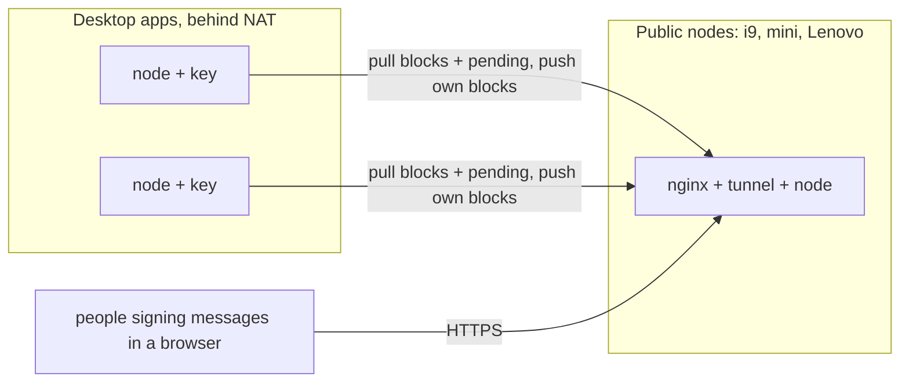

# A node as a desktop app: one click, one card signature

Status on 2026-11-05. A vision and the decisions it forces. Nothing is built yet. It is written down so that the work on the Lenovo, Mac Mini and i9 nodes moves toward it instead of away from it.

Related: [A Windows node, and what hardware a fleet of nodes needs](2026-11-04-windows-node-and-node-hardware.md), [eidchain.domovina.ai and eID validators](2026-11-04-eidchain-domovina-and-eid-validators.md), [Web eID for Windows, built from WSL](2026-11-05-web-eid-windows-build-from-wsl.md).

## The goal

An ordinary person downloads `eidchain.msi` (Windows) or `eidchain.dmg` (macOS) from a web page, not from GitHub. They install it, put their eOI card in the reader and type PIN2 once. From then on their computer is a node and their validator, and nothing else is asked of them: no Go, no scripts, no terminal, no versions, no domain, no tunnel.

**Why it matters.** The chain's safety is one vote per person (README, eID validators). That only means something if there are many persons. Today a person can join only if they can run `join.sh`, `install.sh`, `sudo` and `cloudflared tunnel login`. So in practice the voters are the people who already run servers. The chain needs voters who don't.

## What a person does today, and what the app does instead

| Today (i9, mini, Lenovo) | In the app | Why the change is possible |
| --- | --- | --- |
| Install Go, clone, `go build` | Nothing. The installer carries the binary | The node is pure Go, so one binary per OS/arch, cross-compiled from one machine |
| `eidchain pull --genesis-hash …` | First start pulls from built-in seed nodes | The genesis hash is the chain's identity, so it is built in, not typed. Every block is verified anyway |
| `eidchain keygen` | First start makes the key, in the OS key store (see Keys) | |
| `validator request`, paste into `validator.html`, sign with Web eID | One screen: who you are, what becomes public, PIN2 | The app talks to the card itself (see The card) |
| nginx, cloudflared, `eidchain.env`, `sudo install.sh` | None of it, by default | The node only needs outbound connections (see Reachability) |
| Updates by `git pull && install.sh` | Signed automatic updates | Consensus changes need every node on the new version before the activation height |

## Prerequisite: an outbound-only validator

This is the first thing to build, because everything else depends on it.

A node behind NAT can already pull blocks and push its own (README, Peers). But the messages waiting for a block reach a node only when someone pushes them to it (`broadcastPayload` in `internal/node/gossip.go`), and a public node can't push to an address it can't reach. So a desktop validator would never have anything to put in a block and would never sign. Its key would stay a candidate, or drop back to one after `max(16, 4N)` blocks.

The fix: `syncPeer` also pulls the peer's pending payloads and rotations, and validates them like pushed ones. With that, a desktop node needs no public address, no tunnel and no nginx. That removes the part of today's setup that only a person with a Cloudflare account can do.

Public nodes stay what they are now, a few machines run by people who can. They take messages from the web and connect the desktop nodes to each other. Nobody has to trust them: they can delay a message, but every block is validated by every node. To keep the public nodes from becoming a choke point, the app can let a user opt into being public later. That needs the nginx limits moved into the node itself, because a desktop node has no nginx in front of it and the node has no limits of its own today.

## The card

Today the card signs through Web eID: a browser extension, a native host and libelectronic-id. The newer eOI needs our fork of libelectronic-id on every OS, because of its ATR. An average user can't be asked to install a forked browser extension stack. So **the app talks to the card itself** over PC/SC (WinSCard on Windows, the PC/SC framework on macOS). It sends the same APDUs that libelectronic-id sends to the eSign application, and it shows the certificate and the record before PIN2.

Why not bundle Web eID: it would still mean an extension in every browser, a native-messaging registration and the ATR list, and that is exactly the part that broke for us. The registration is the one card operation the app needs, and it happens once per key.

The cost: our app then handles PIN2. The PIN entry must be plain and local, never logged, never sent anywhere. A pinpad reader should be used when present. The signing code must be small enough to review.

The browser flow (`validator.html` + Web eID) stays for people who run nodes by hand.

## Keys

- **The node key is made in hardware and can't be exported.** That is the Secure Enclave on Macs and the TPM on Windows (CNG Platform Crypto Provider). Both support P-256 ECDSA, which is what node keys are today. Why: the worst mistake a validator can make is to run one key on two nodes, because both sign at once and fork the chain (README, eID validators). A key that can't leave the machine can't be copied. Malware on the machine can still sign with it while it runs, but it can't steal it.
- No backups of the key. A new machine makes a new key. The person registers it with the card, and the old one is retired in the same record (`retire`). A person may hold 16 keys, so a lost machine costs nothing but a card signature.
- Without a TPM or a Secure Enclave, fall back to a file readable only by the service (DPAPI on Windows, the Keychain on macOS), and say so in the app.

## Running in the background

- **Windows:** the MSI installs the node as a Windows service (one UAC prompt, normal for an installer) and a tray app for the person. The service runs with nobody logged on and survives restarts. That is what WSL needed a Scheduled Task for on the Lenovo.
- **macOS:** an app bundle in a `.dmg`, drag to Applications. On first start it registers its node as a LaunchDaemon with `SMAppService` (macOS 13+). That is what `deploy/macos/install.sh` does today with `sudo`. The menu bar shows the status.
- **Sleep is fine.** A laptop that sleeps simply doesn't sign. If it is away long enough, its key becomes a candidate and counts again after its next block. So the app shouldn't fight the OS's power settings, unlike a server node.
- The UI shows: synced or not, height, whether this key is active or a candidate, when it last signed, and the card registration's expiry (a key goes when its certificate expires).

UI toolkit: [Wails](https://wails.io) is the first choice. It is Go plus the system webview, so the node, the card code and the UI are one Go codebase, and the existing `www/` pages can be reused. Electron is too heavy for a background app. Tauri would add Rust.

## Updates

Feature changes activate at a height. Every validator must run the new version before that height, or it stops following the chain. So updates must be automatic, signed and checked before they are applied: Sparkle on macOS, and the app's own updater or the MSI's on Windows.

Whoever signs the updates controls what every validator runs. That is a larger power than any key on the chain. To limit it: reproducible builds, a published hash per release, and later updates that need signatures from several people. That fits the chain's own idea of authority.

## Code signing is a requirement, not polish

Without it, Windows SmartScreen and macOS Gatekeeper warn people away from the installer, and the average user stops there.

- Windows: Authenticode, with Azure Trusted Signing or an OV certificate. See the open item in the Web eID Windows build doc.
- macOS: Developer ID (Apple Developer Program, $99 a year) and notarization.

## Telling people what becomes public

Registering puts the person's name in a public, permanent chain, and the certificate that comes with the record contains their personal ID number (OIB) (README, eID validators). A person who clicked "next" in an installer didn't agree to that. The signing screen must say so in plain Croatian before PIN2, with a link to what exactly is published. This needs a GDPR review before a public release. A chain can't delete anything, so it should be settled before the first stranger signs.

## Order of work

1. Pending payloads and rotations pulled on sync (the prerequisite). Small, and it helps today's nodes too.
2. Card signing over PC/SC in Go, as a CLI first: `eidchain validator register --card`. It replaces Web eID for registration on all three OSes and is testable without any UI.
3. Hardware-bound node keys (Secure Enclave, TPM) behind the existing key loading.
4. The app: Wails UI, Windows service + MSI, macOS SMAppService + dmg, built in CI for windows/amd64, darwin/arm64 and darwin/amd64.
5. Signing, notarization, the updater.
6. Optional public mode: limits in the node, a tunnel or a port the person opens.

## Open questions for Matija

- Who publishes and signs the app (domovina.ai, a person, an association)? It decides who holds the update power and whose name is on the certificate.
- Should desktop nodes stay private for good, or should the app later offer a public mode? If so, how does a person get a hostname without our Cloudflare account?
- Linux desktop: a `.deb`/AppImage as well, or servers only?
- Seed nodes built into the app: only domovina.ai nodes, or also ivoras.net?
