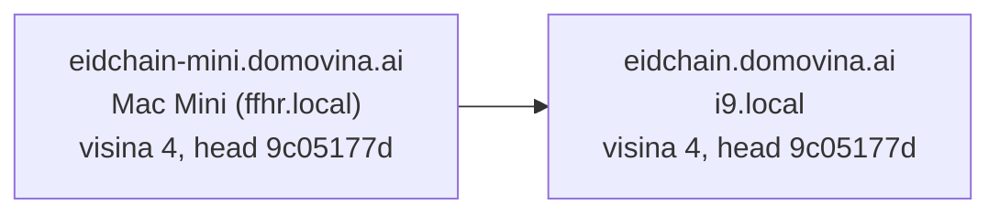
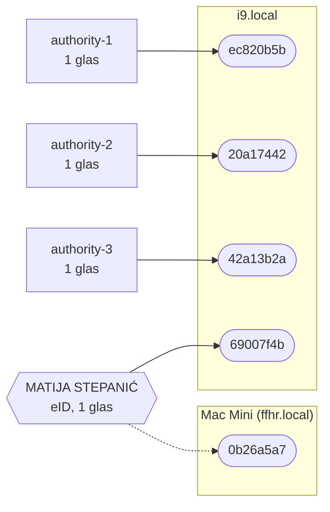

# eidchain: čvorovi i ključevi

Generirano **04.11.2026. 16:44 (CET)** skriptom `scripts/chain-map.py`. Ne uređivati ručno: svako pokretanje prepisuje dokument stanjem lanca u tom trenutku.

- Lanac `70659df25175`, visina **4**, head `9c05177d5b80`
- Javnih čvorova: **2** od 2 poznatih
- Glasača (N): **4**, signer window 2, kvorum za rotaciju 3
- Ključeva koji smiju potpisivati: 5 (aktivnih 4, kandidata 1)
- Poruka na čekanju: 0

## Čvorovi i tko koga zna

Strelica A → B: A ima B na popisu peerova, pa gura blokove prema B i povlači s njega. Vidljivi su samo čvorovi s javnom adresom.

## Ključevi, osobe i čvorovi

Glas ima osoba (eID) ili ključ bez osobe (genesis). Svi ključevi jedne osobe su jedan glas. Puna linija: aktivan ključ. Isprekidana: kandidat, koji počinje vrijediti kad potpiše blok.

## Ključevi

| ključ | čiji | stanje | čvor | zadnji potpisani blok |
|---|---|---|---|---|
| `ec820b5b` | authority-1 | aktivan | eidchain.domovina.ai (iz hints) | 3 |
| `20a17442` | authority-2 | aktivan | eidchain.domovina.ai (iz hints) | 2 |
| `42a13b2a` | authority-3 | aktivan | eidchain.domovina.ai (iz hints) | — |
| `69007f4b` | MATIJA STEPANIĆ | aktivan | eidchain.domovina.ai (iz hints) | 4 |
| `0b26a5a7` | MATIJA STEPANIĆ | kandidat | eidchain-mini.domovina.ai | — |

## Čvorovi

| čvor | stanje | visina | čeka | potpisuje | radi od |
|---|---|---|---|---|---|
| eidchain.domovina.ai | može rezati blok | 4 | 0 | 4 | 04.11. 16:22 |
| eidchain-mini.domovina.ai | čeka svoj red | 4 | 0 | 1 | 04.11. 16:43 |

## Zadnji blokovi

| visina | vrijeme | potpisao | poruka |
|---|---|---|---|
| 4 | 04.11. 16:40 | `69007f4b` MATIJA STEPANIĆ | 1 |
| 3 | 04.11. 16:20 | `ec820b5b` authority-1 | 1 |
| 2 | 04.11. 15:40 | `20a17442` authority-2 | 1 |
| 1 | 04.11. 15:30 | `ec820b5b` authority-1 | 1 |
